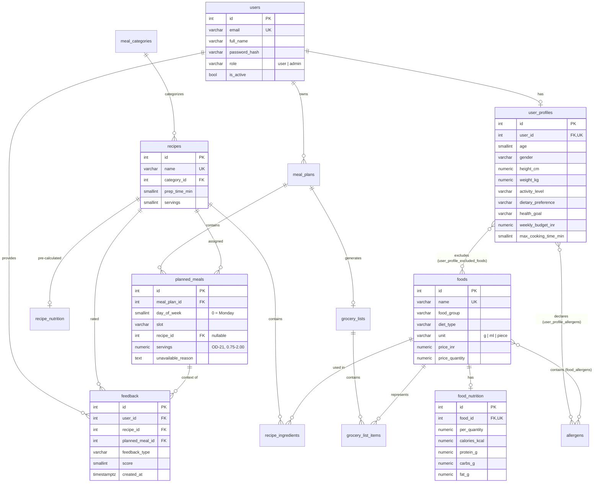

# Database Design

PostgreSQL 17, managed with SQLAlchemy 2.x models (`backend/app/models/`) and Alembic
migrations (`backend/alembic/versions/`). The design follows the ER diagram (Lab 2) and class
diagram (Lab 4), normalised and extended where the requirements need structure (allergens,
pre-calculated recipe nutrition).

## Entity–relationship diagram

## Tables

| Table | Purpose | Key constraints |
| --- | --- | --- |
| `users` | Accounts (USER) | `uq_users_email`; `role` ∈ {user, admin}; password stored only as a hash |
| `user_profiles` | Profile inputs (USER_PROFILE) | one per user; range checks on age, height, weight, budget (> 0), cooking time |
| `allergens` | Allergen reference list (seeded: Peanuts, Tree Nuts, Dairy, Egg, Gluten, Soy, Fish, Shellfish, Sesame, Mustard) | unique name |
| `user_profile_allergens` | Declared allergies (structural) | composite PK |
| `user_profile_excluded_foods` | Ingredient-specific exclusions | composite PK |
| `foods` | Ingredients (FOOD) with canonical unit and price | unique name; price ≥ 0; `price_quantity` > 0 |
| `food_allergens` | Which allergens a food contains | composite PK |
| `food_nutrition` | NUTRITION VALUE per `per_quantity` of the food's unit | one per food; macros ≥ 0 |
| `meal_categories` | The four fixed categories (seeded) | unique `slot` and `name` |
| `recipes` | RECIPE with preparation time and exactly one category | `category_id NOT NULL`, `ON DELETE RESTRICT`; prep time > 0 |
| `recipe_ingredients` | RECIPE INGREDIENT quantity + unit | unique (recipe, food); quantity > 0 |
| `recipe_nutrition` | Pre-calculated per-serving nutrition and estimated cost | 1:1 with recipe; values ≥ 0 |
| `meal_plans` | WEEKLY PLAN per user and week | index (user_id, week_start_date) |
| `planned_meals` | PLAN ITEM: day × slot → recipe **or** explanation, with portion size | unique (plan, day, slot); day 0–6; `recipe_id` or `unavailable_reason` required; `servings > 0` (migration `0003`, OD-21) |
| `user_sessions` | Login sessions (OD-12) | SHA-256 `token_hash` unique (the raw token is never stored); `expires_at`; cascades from `users` (migration `0002`) |
| `grocery_lists` / `grocery_list_items` | Aggregated, de-duplicated ingredients | one list per plan; unique (list, food) |
| `feedback` | Feedback events with weighted score | score ∈ {−3, −1, 1, 3}; index (user, recipe) |

## Conventions

* **Money** – `NUMERIC(10,2)` in INR (`*_inr` columns); never floating point.
* **Units** – every food has one canonical unit (`g`, `ml`, `piece`); prices are per
  `price_quantity` of that unit (e.g. ₹60 per 1000 g) and nutrition per `per_quantity`
  (e.g. per 100 g). Recipe ingredient quantities use the same unit (validated by the service
  layer in M2). Display conversion (g → kg) happens only in the presentation layer.
* **Enumerations** – stored as `VARCHAR` with named `CHECK` constraints (not native PostgreSQL
  enum types) so values can evolve with simple migrations.
* **Names** – deterministic constraint names via a naming convention
  (`pk_`, `uq_`, `fk_`, `ck_`, `ix_`), keeping migrations reviewable.
* **Timestamps** – `created_at` / `updated_at` (`timestamptz`) set by the database.
* **Deletes** – user-owned data cascades from `users`; catalogue references use `RESTRICT`
  so a recipe or food in use cannot silently disappear from plans; feedback keeps its
  history when a planned meal is removed (`SET NULL`).

## Design tension: category CRUD vs fixed categories

REQ-4.7.5 asks for admin create/update/delete of categories, while SRS §2.5/§5.5/Appendix A
fix the categories to breakfast, lunch, dinner and snack. The schema preserves the four core
categories (seeded, unique `slot`). Admins can edit their names/descriptions; creating or
deleting categories is rejected with 409 and an explanation. See
[open-decisions.md – OD-02](../requirements/open-decisions.md#od-02--category-crud-vs-fixed-categories).

## Seed / reference data

The initial migration inserts only **reference data the schema depends on** – the four meal
categories and the allergen list. Foods, prices and nutrition values are **not** part of any
migration: the clearly labelled illustrative development dataset (OD-15; 72 foods, 100
recipes in `app/seed/catalogue_data.py`) is loaded on demand with
`python -m app.cli seed-catalogue`, which does nothing if foods already exist. No admin
account or password is ever created by a migration; `python -m app.cli create-admin` reads
the credentials from environment variables.
