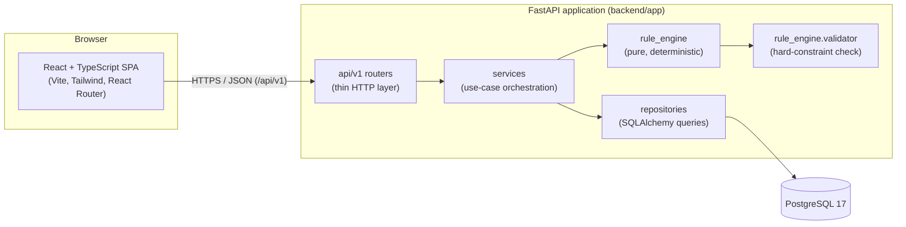
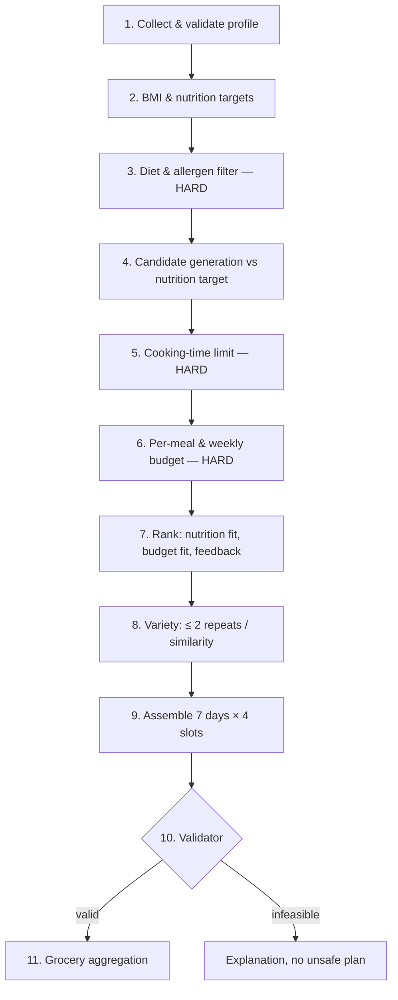

# Architecture Overview

NutriPlan Release 1.0 (Phase 1) is a monorepo containing a React single-page application,
a FastAPI REST API with a deterministic rule engine, and a PostgreSQL database. The structure
mirrors the component diagram (Lab 6): Web Client → Application Server (authentication,
profile management, nutrition calculator, recommendation engine, meal replacement, grocery
list generator, feedback processing, dashboard service) → NutriPlan Database.

## Layers and responsibilities

| Layer | Location | Responsibility | Must not |
| --- | --- | --- | --- |
| Pages / features | `frontend/src/pages`, `frontend/src/features` | Screens and feature UI | Call `fetch` directly – use `lib/apiClient.ts` |
| UI primitives / layout | `frontend/src/components` | Reusable buttons, cards, states, navigation | Contain business logic |
| API client | `frontend/src/lib/apiClient.ts` | Base URL, JSON, error parsing, timeouts | Hard-code hosts |
| Routers | `backend/app/api/v1` | HTTP: validation, status codes, auth dependencies | Contain business rules or SQL |
| Schemas | `backend/app/schemas` | Pydantic request/response contracts | Leak ORM objects |
| Services | `backend/app/services` | Use cases: load data, call the engine, persist results | Bypass the validator |
| Repositories | `backend/app/repositories` | Persistence queries per aggregate | Hold business rules |
| Rule engine | `backend/app/rule_engine` | Nutrition targets, filters, ranking, variety, planning, validation | Import FastAPI, sessions or the DB |
| Models | `backend/app/models` | SQLAlchemy entities + constraints | – |
| Core | `backend/app/core` | Settings, logging, error format, security, CSRF, request dependencies | – |

Dependencies point inward: `api → services → (repositories, rule_engine)`. The rule engine
works on plain dataclasses (`rule_engine/types.py`) so every rule is unit-testable without a
database (SRS §5.4 Maintainability).

## Recommendation pipeline (Phase 1)

Hard constraints are never relaxed to improve ranking, variety or satisfaction. When a slot
or the whole plan cannot be satisfied, the response carries an explicit explanation
(REQ-4.2.8; interpretation of "closest feasible" in OD-01).

### Phase 2 placement (not implemented)

Phase 2 inserts an LLM personalisation layer **between** ranked candidates and the validator:
`Rule Engine → Candidates → LLM layer → Validator → Final plan`. Because the validator is a
separate module operating on plain data, it can be reused unchanged. No LLM calls, ML models
or vector stores exist in this codebase.

## Cross-cutting concerns

* **Configuration** – `pydantic-settings` (`app/core/config.py`), from environment variables /
  `backend/.env`. No secrets in the repository.
* **Errors** – one JSON shape: `{"error": {"code", "message", "details?"}}`
  (`app/core/errors.py`), parsed by `ApiError` on the client.
* **Logging** – JSON log lines with request id, method, path, status and duration
  (`app/core/logging.py`); `X-Request-ID` is echoed in responses.
* **CORS / proxy** – in development the Vite server proxies `/api` to `127.0.0.1:8000`, so
  the browser uses one origin; CORS allows the Vite origins as a fallback.
* **Security** – Argon2id password hashing, opaque HttpOnly session cookie (hash stored in
  `user_sessions`, `Secure` in production), double-submit CSRF token on every state-changing
  request (`app/core/csrf.py`), backend-enforced RBAC (`require_user` / `require_admin` in
  `app/core/deps.py`), queries always filtered by the authenticated user, HTTPS at the reverse
  proxy in production. Registration can never assign the admin role (OD-12).

## Runtime topology (development)

| Process | Address | Command |
| --- | --- | --- |
| PostgreSQL (Docker) | `127.0.0.1:5433` → container `5432` | `docker compose up -d db` |
| FastAPI | `http://127.0.0.1:8000` (`/docs`) | `python -m uvicorn app.main:app --reload` |
| Vite | `http://localhost:5173` | `npm run dev` |

## Runtime topology (production)

One container built from the root `Dockerfile` (Node 22 builds the frontend; Python 3.14 slim
runs it as a non-root user). On start it runs `alembic upgrade head`, then Uvicorn serves the
API under `/api/v1` **and** the built React app (`FRONTEND_DIST_DIR`, unknown paths fall back
to `index.html` for client-side routing, unknown `/api` paths still return the JSON 404). The
browser therefore talks to one origin – no CORS. PostgreSQL is external (`DATABASE_URL`), TLS
terminates at a reverse proxy, and `docker compose --profile prod up --build` runs the same
image locally against the Compose database.
