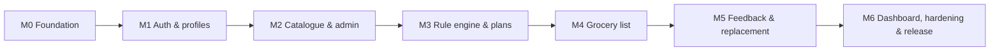

# Development Roadmap

NutriPlan is delivered in **7 phases (milestones M0–M6)**, following the Agile sprint order in
the Work Breakdown Structure (Sprint 1: authentication & profile; Sprint 2: food database &
recommendation engine; Sprint 3: meal planner & grocery list; Sprint 4: feedback & dashboard)
and the Gantt chart (core development → integration & testing → documentation & submission).
Each milestone ends with passing CI and an updated
[requirements matrix](requirements/requirements-matrix.md).

| Phase | Milestone | Scope | Requirements | Exit criteria |
| --- | --- | --- | --- | --- |
| 1 | **M0 – Project foundation** ✅ | Monorepo, FastAPI scaffold + health endpoint, SQLAlchemy models, initial Alembic migration, Docker PostgreSQL, React/Vite/Tailwind shells for all screens, tests, CI, docs | Structure for all; §5.2 disclaimer | Both apps start; migration applies; health endpoint reachable from the UI; CI green |
| 2 | **M1 – Authentication & user profiles** ✅ | Register/login/logout, Argon2id hashing, session cookie + CSRF (migration `0002`), `require_user` / `require_admin`, `create-admin` CLI, profile create/edit with validation, nutrition calculator (BMI, calorie & protein target), React Hook Form + Zod forms, protected routes | REQ-4.1.1–4.1.5, §5.3, OD-06/11/12 | Users can register, log in, save/edit a profile and see their nutrition target; admin role cannot be self-assigned |
| 3 | **M2 – Food catalogue & admin panel** ✅ | Admin CRUD for foods, nutrition values, recipes (+ ingredients, prep time), categories (OD-02); recipe nutrition & cost pre-calculation; labelled illustrative seed dataset (72 foods, 100 recipes, `seed-catalogue` CLI) | REQ-4.7.1–4.7.5, OD-15/16 | Admin can maintain the catalogue; non-admins receive 403 |
| 4 | **M3 – Rule engine & weekly meal plans** ✅ | `rule_engine` implementation (filters, ranking, variety, planner, validator), portion sizing (OD-21, migration `0003`), plan generation API, weekly plan & meal detail views, infeasibility explanations | REQ-4.2.1–4.2.8, §5.1, §5.4, OD-01/03/05/08/17/18/21 | Deterministic 7×4 plans that always pass the validator; ≤ 5 s generation |
| 5 | **M4 – Grocery list generator** ✅ | Aggregation, de-duplication, unit normalisation, cost estimate vs budget, grocery list view grouped by food group | REQ-4.3.1, 4.3.2, 4.3.4 | Correct aggregated list for any plan |
| 6 | **M5 – Feedback & meal replacement** ✅ | Feedback events and weighted scores, ranking adjustment, favourites → similar meals, single-meal replacement with automatic grocery regeneration | REQ-4.4.1–4.4.4, 4.5.1–4.5.5, 4.3.3, OD-07 | Feedback changes future plans; replacements never violate constraints |
| 7 | **M6 – Dashboard, hardening & release** ✅ | Dashboard with Recharts, in-app help/FAQ and admin guide, accessibility (landmarks, skip link, visible focus, labelled forms) and security hardening (CSRF, RBAC, per-user queries, Secure cookies in production), response-time tests, production `Dockerfile` (single origin, `FRONTEND_DIST_DIR`), PostgreSQL full-flow integration test, documentation | REQ-4.6.1–4.6.4, §2.6, §5, OD-19/20 | All REQs traced to passing tests; deployable build |

## Release 1.0 status

All milestones are complete. All 35 functional requirements are implemented and traced to
passing tests in the [requirements matrix](requirements/requirements-matrix.md). Remaining
items need a Product Owner decision, not code:

* **OD-06, OD-11, OD-15, OD-16** are implemented as proposed and still need formal sign-off.
* **OD-19 / OD-20** (documentation format, hosting, concurrency, uptime – SRS TBD-1…4): the
  release ships in-app help and a provider-neutral container image; targets are not set.
* HTTPS (SRS §5.3) is provided by the hosting reverse proxy at deployment time.

## Out of scope for Release 1.0

Phase 2 LLM personalisation layer, AI chatbot, live price feeds, barcode scanning, wearable
integration and any machine-learning recommendation engine (Project Description §4.2, SRS §1.1).
